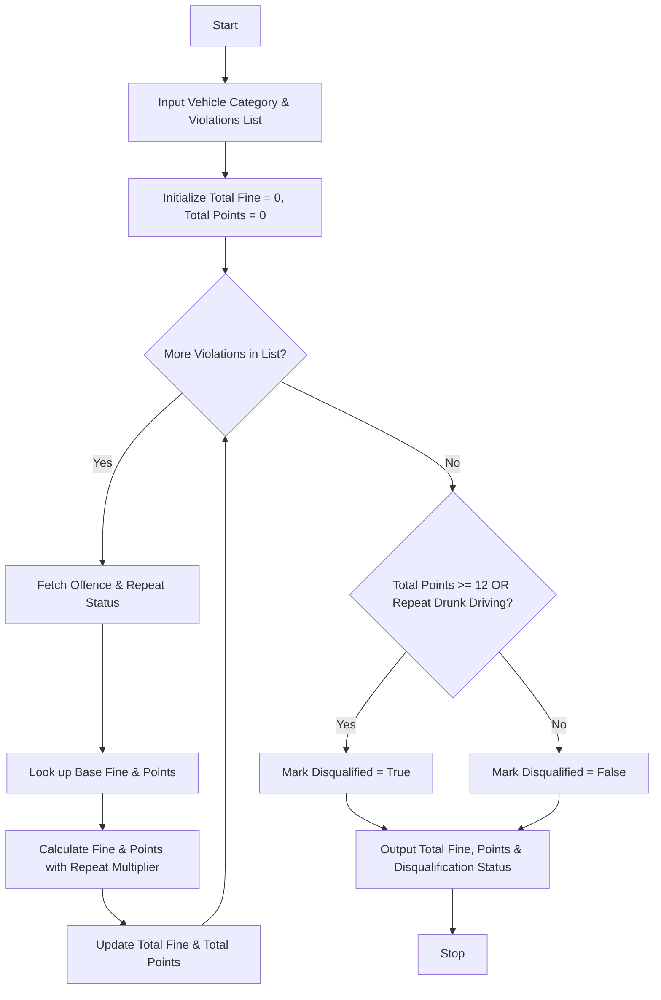

## Problem Statement

Develop a Traffic Violation Penalty Calculator system that processes multiple traffic offences for a given vehicle. The system must evaluate the vehicle category (e.g., Two-Wheeler, Light Motor Vehicle, Heavy Vehicle), the specific offence type, and whether the offence is a repeat violation. Based on predefined fine schedules and penalty point rules, the program must calculate the total monetary fine, aggregate total penalty points, and evaluate specific criteria to determine if the driver is subject to license disqualification.

---

## Algorithm

1. **Initialize Data Structures**:
* Define base fine tables mapped by vehicle category and offence type.
* Define penalty point values for each offence type.


2. **Input Collection**:
* Accept the vehicle category and a list of violations, where each violation contains the offence type and the count of prior occurrences (repeat status).


3. **Process Each Violation**:
* Retrieve the base fine and base penalty points for the offence based on the vehicle category.
* If the repeat status is greater than zero, apply a multiplier (e.g., 1.5x) to the fine and scale the penalty points accordingly.
* Accumulate the fine and penalty points into total sums.


4. **Check Disqualification Conditions**:
* Evaluate if total accumulated penalty points exceed the threshold (e.g., 12 points).
* Check for severe violation triggers (e.g., repeat Drunk Driving).


5. **Output Results**:
* Display the total penalty fine, total penalty points, disqualification status, and specific reasons if disqualified.


---

## Flowchart



---

## Python Source Code

```python
def calculate_fine(vehicle_category, offence_type, repeat_count):
    base_fines = {
        "Two-Wheeler": {
            "Speeding": 1000,
            "Red Light": 500,
            "No Helmet": 500,
            "Drunk Driving": 10000,
            "No License": 5000
        },
        "LMV": {
            "Speeding": 2000,
            "Red Light": 1000,
            "No Seatbelt": 1000,
            "Drunk Driving": 15000,
            "No License": 5000
        },
        "Heavy Vehicle": {
            "Speeding": 5000,
            "Red Light": 2000,
            "No Seatbelt": 2000,
            "Drunk Driving": 20000,
            "No License": 10000
        }
    }
    
    fine_points = {
        "Speeding": 3,
        "Red Light": 3,
        "No Helmet": 1,
        "No Seatbelt": 1,
        "Drunk Driving": 10,
        "No License": 6
    }
    
    base = base_fines.get(vehicle_category, {}).get(offence_type, 1000)
    multiplier = 1.5 if repeat_count > 0 else 1.0
    final_fine = int(base * multiplier)
    points = fine_points.get(offence_type, 2) * (1 + repeat_count)
    return final_fine, points

def process_violations(vehicle_category, violations):
    total_fine = 0
    total_points = 0
    disqualified = False
    reasons = []
    
    for offence, repeat_count in violations:
        fine, pts = calculate_fine(vehicle_category, offence, repeat_count)
        total_fine += fine
        total_points += pts
        if offence == "Drunk Driving" and repeat_count > 0:
            disqualified = True
            reasons.append("Repeat Drunk Driving offence")
            
    if total_points >= 12:
        disqualified = True
        reasons.append("Accumulated 12 or more penalty points")
        
    return total_fine, total_points, disqualified, reasons

if __name__ == "__main__":
    vehicle = "LMV"
    violation_list = [
        ("Speeding", 0),
        ("Red Light", 1),
        ("No Seatbelt", 0)
    ]
    
    fine, points, is_disqualified, disqualification_reasons = process_violations(vehicle, violation_list)
    print(f"Vehicle Category: {vehicle}")
    print(f"Total Fine: ${fine}")
    print(f"Total Penalty Points: {points}")
    print(f"Disqualified: {is_disqualified}")
    if is_disqualified:
        print(f"Reasons: {', '.join(disqualification_reasons)}")

```

---

## Sample Input

```python
vehicle_category = "LMV"
violations = [
    ("Speeding", 0),
    ("Red Light", 1),
    ("No Seatbelt", 0)
]

```

---

## Sample Output

```text
Vehicle Category: LMV
Total Fine: $4500
Total Penalty Points: 8
Disqualified: False

```
