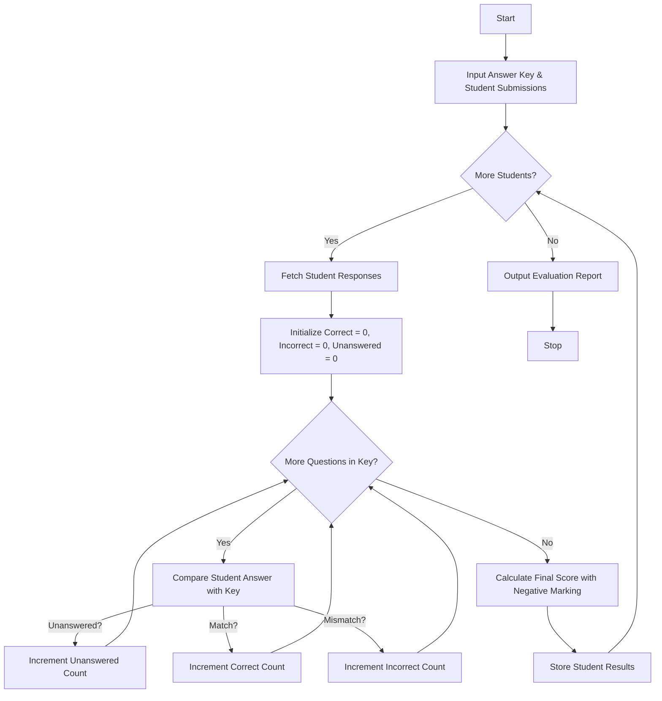

## Problem Statement

Develop a String-Based Examination Answer Evaluation system that processes student response strings against a master answer key. The system must compare the responses character by character, categorize each answer as correct, incorrect, or unanswered, apply configurable positive scoring and negative marking rules, and produce comprehensive student-wise results and scores.

---

## Algorithm

1. **Initialize Parameters**:
* Define the master answer key and grading weights (marks per correct answer and negative penalty for incorrect answers).


2. **Input Collection**:
* Accept a dictionary containing student identifiers mapped to their respective answer strings or token lists.


3. **Process Each Student Response**:
* Iterate through the student's answers in parallel with the answer key.
* Identify unanswered tokens (e.g., `-` or `X`).
* Compare given answers with key answers to count correct and incorrect responses.


4. **Calculate Scores**:
* Compute final score using the formula: $(\text{Correct} \times \text{Positive Marks}) - (\text{Incorrect} \times \text{Negative Marks})$.


5. **Output Results**:
* Compile and display individual performance metrics including breakdown counts and final scores for each student.


---

## Flowchart



---

## Python Source Code

```python
def evaluate_exams(answer_key, students_responses, positive_marks=4.0, negative_marks=1.0):
    results = {}
    for student_id, responses in students_responses.items():
        correct = 0
        incorrect = 0
        unanswered = 0
        
        for stud_ans, key_ans in zip(responses, answer_key):
            if stud_ans == '-' or stud_ans.upper() == 'X':
                unanswered += 1
            elif stud_ans.upper() == key_ans.upper():
                correct += 1
            else:
                incorrect += 1
                
        score = (correct * positive_marks) - (incorrect * negative_marks)
        results[student_id] = {
            "correct": correct,
            "incorrect": incorrect,
            "unanswered": unanswered,
            "score": score
        }
    return results

if __name__ == "__main__":
    key = ["A", "B", "C", "D", "A"]
    submissions = {
        "S101": ["A", "B", "C", "D", "A"],
        "S102": ["A", "C", "C", "-", "B"],
        "S103": ["D", "B", "A", "D", "X"]
    }
    
    evaluation = evaluate_exams(key, submissions)
    for sid, res in evaluation.items():
        print(f"Student {sid}: Correct={res['correct']}, Incorrect={res['incorrect']}, Unanswered={res['unanswered']}, Score={res['score']}")

```

---

## Sample Input

```python
answer_key = ["A", "B", "C", "D", "A"]
students_responses = {
    "S101": ["A", "B", "C", "D", "A"],
    "S102": ["A", "C", "C", "-", "B"],
    "S103": ["D", "B", "A", "D", "X"]
}
positive_marks = 4.0
negative_marks = 1.0

```

---

## Sample Output

```text
Student S101: Correct=5, Incorrect=0, Unanswered=0, Score=20.0
Student S102: Correct=1, Incorrect=3, Unanswered=1, Score=1.0
Student S103: Correct=2, Incorrect=2, Unanswered=1, Score=6.0

```
