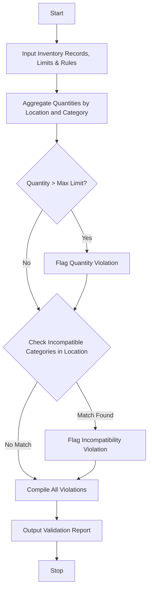

## Problem Statement

Develop a Laboratory Chemical Inventory Validation system that evaluates hypothetical chemical inventory records against safety constraints. The system must process storage categories, maximum quantity limits per storage location, and chemical compatibility restrictions (such as prohibiting the storage of flammables near oxidizers or acids near bases) to automatically identify and flag invalid storage combinations and quantity violations.

---

## Algorithm

1. **Initialize Constraints & Rules**:
* Define maximum quantity limits for each storage category at specific locations.
* Define a set of incompatible chemical category pairs (e.g., Flammable and Oxidizer).


2. **Input Collection**:
* Accept the list of chemical inventory items, including name, category, quantity, and storage location.


3. **Aggregate and Check Quantities**:
* Sum total quantities for each chemical category within each storage location.
* Compare aggregated quantities against predefined storage limit thresholds; flag any excess.


4. **Check Chemical Compatibility**:
* Inspect all categories present within each unique storage location.
* Check if any pair of categories matches the list of known incompatibility rules.


5. **Output Results**:
* Compile and display all flagged quantity and compatibility violations.


---

## Flowchart



---

## Python Source Code

```python
def validate_inventory(inventory, storage_limits, incompatibilities):
    location_quantities = {}
    location_chemicals = {}
    
    for item in inventory:
        name = item["name"]
        category = item["category"]
        qty = item["quantity"]
        location = item["location"]
        
        location_quantities[(location, category)] = location_quantities.get((location, category), 0) + qty
        
        if location not in location_chemicals:
            location_chemicals[location] = set()
        location_chemicals[location].add(category)
        
    violations = []
    
    for (loc, cat), total_qty in location_quantities.items():
        max_limit = storage_limits.get(loc, {}).get(cat, float("inf"))
        if total_qty > max_limit:
            violations.append(f"Quantity violation at {loc} for {cat}: Total {total_qty} exceeds limit {max_limit}")
            
    for loc, categories in location_chemicals.items():
        cat_list = list(categories)
        for i in range(len(cat_list)):
            for j in range(i + 1, len(cat_list)):
                c1, c2 = cat_list[i], cat_list[j]
                if (c1, c2) in incompatibilities or (c2, c1) in incompatibilities:
                    violations.append(f"Incompatibility violation at {loc}: {c1} stored with {c2}")
                    
    return violations

if __name__ == "__main__":
    limits = {
        "Cabinet A": {"Flammable": 5.0, "Acid": 10.0},
        "Cabinet B": {"Oxidizer": 2.0, "Base": 10.0}
    }
    
    incompat_rules = {
        ("Flammable", "Oxidizer"),
        ("Acid", "Base")
    }
    
    current_inventory = [
        {"name": "Acetone", "category": "Flammable", "quantity": 6.0, "location": "Cabinet A"},
        {"name": "Hydrogen Peroxide", "category": "Oxidizer", "quantity": 1.0, "location": "Cabinet A"},
        {"name": "Hydrochloric Acid", "category": "Acid", "quantity": 4.0, "location": "Cabinet B"},
        {"name": "Sodium Hydroxide", "category": "Base", "quantity": 3.0, "location": "Cabinet B"}
    ]
    
    results = validate_inventory(current_inventory, limits, incompat_rules)
    for v in results:
        print(v)

```

---

## Sample Input

```python
storage_limits = {
    "Cabinet A": {"Flammable": 5.0, "Acid": 10.0},
    "Cabinet B": {"Oxidizer": 2.0, "Base": 10.0}
}

incompatibilities = {
    ("Flammable", "Oxidizer"),
    ("Acid", "Base")
}

inventory = [
    {"name": "Acetone", "category": "Flammable", "quantity": 6.0, "location": "Cabinet A"},
    {"name": "Hydrogen Peroxide", "category": "Oxidizer", "quantity": 1.0, "location": "Cabinet A"},
    {"name": "Hydrochloric Acid", "category": "Acid", "quantity": 4.0, "location": "Cabinet B"},
    {"name": "Sodium Hydroxide", "category": "Base", "quantity": 3.0, "location": "Cabinet B"}
]

```

---

## Sample Output

```text
Quantity violation at Cabinet A for Flammable: Total 6.0 exceeds limit 5.0
Incompatibility violation at Cabinet A: Flammable stored with Oxidizer

```
