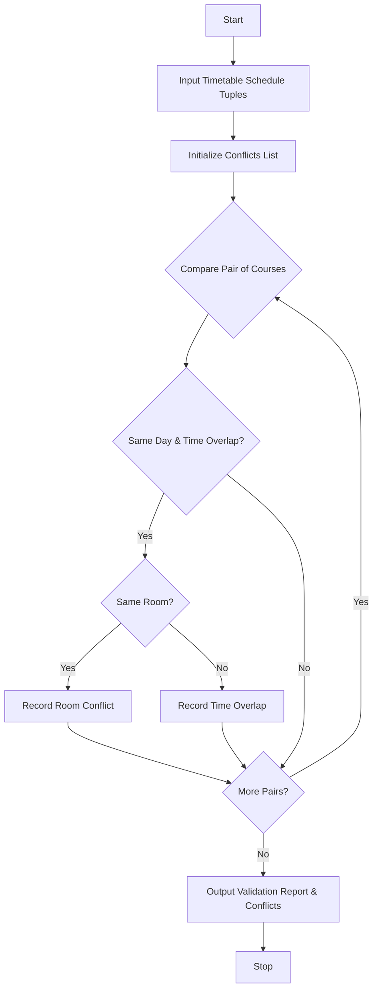

## Problem Statement

Develop a Student Timetable Conflict Detection system that ingests course schedules represented as tuples containing course names, days, time intervals, and room identifiers. The system must analyze the schedule entries to detect overlapping time periods for students and identify unavailable or doubly-booked rooms, thereby validating the proposed timetable and reporting all conflicts.

---

## Algorithm

1. **Initialize Data Structures**:
* Define a schedule schema using tuples: `(course_name, day, start_time, end_time, room)`.


2. **Input Collection**:
* Accept a list of scheduled course entries.


3. **Time Conversion and Comparison**:
* Convert time string formats (HH:MM) into total minutes from midnight for accurate overlap computation.
* Compare every pair of courses in the timetable.


4. **Conflict Detection**:
* Check if two courses occur on the same day and their time intervals overlap (`max(start1, start2) < min(end1, end2)`).
* Check if overlapping courses share the exact same room identifier.


5. **Output Results**:
* Compile and print all identified time overlaps and room conflicts.


---

## Flowchart



---

## Python Source Code

```python
def time_to_minutes(time_str):
    parts = time_str.split(":")
    return int(parts[0]) * 60 + int(parts[1])

def check_overlap(start1, end1, start2, end2):
    s1 = time_to_minutes(start1)
    e1 = time_to_minutes(end1)
    s2 = time_to_minutes(start2)
    e2 = time_to_minutes(end2)
    return max(s1, s2) < min(e1, e2)

def validate_timetable(schedule):
    conflicts = []
    for i in range(len(schedule)):
        for j in range(i + 1, len(schedule)):
            c1_name, c1_day, c1_start, c1_end, c1_room = schedule[i]
            c2_name, c2_day, c2_start, c2_end, c2_room = schedule[j]
            
            if c1_day == c2_day and check_overlap(c1_start, c1_end, c2_start, c2_end):
                if c1_room == c2_room:
                    conflicts.append(f"Room Conflict: {c1_room} booked by {c1_name} and {c2_name} on {c1_day}")
                conflicts.append(f"Time Overlap: {c1_name} and {c2_name} overlap on {c1_day}")
                
    return conflicts

if __name__ == "__main__":
    timetable = [
        ("Math 101", "Monday", "09:00", "10:30", "Room 101"),
        ("Physics 101", "Monday", "10:00", "11:30", "Room 101"),
        ("Chemistry 101", "Monday", "11:00", "12:30", "Room 102")
    ]
    
    results = validate_timetable(timetable)
    for r in results:
        print(r)

```

---

## Sample Input

```python
timetable = [
    ("Math 101", "Monday", "09:00", "10:30", "Room 101"),
    ("Physics 101", "Monday", "10:00", "11:30", "Room 101"),
    ("Chemistry 101", "Monday", "11:00", "12:30", "Room 102")
]

```

---

## Sample Output

```text
Room Conflict: Room 101 booked by Math 101 and Physics 101 on Monday
Time Overlap: Math 101 and Physics 101 overlap on Monday

```
