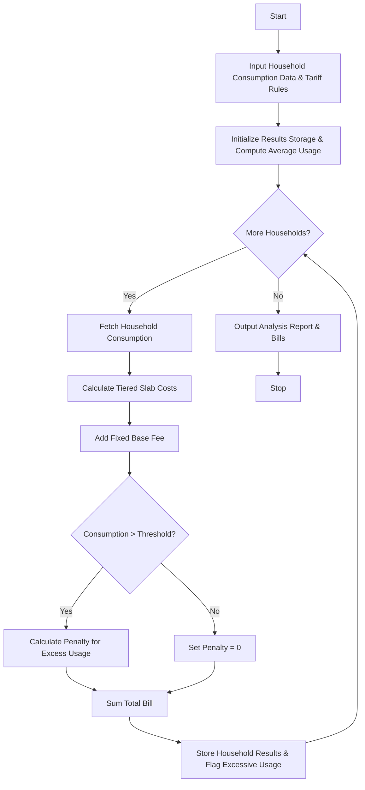

## Problem Statement

Develop a Progressive Water Tariff Analysis system that processes water consumption records for multiple households. The system must compute progressive water bills based on consumption slabs (tiered pricing rates), add fixed service fees, apply penalties for consumption exceeding a defined sustainability threshold, and analyze consumption patterns to flag excessive usage compared to the average.

---

## Algorithm

1. **Initialize Tariff Structure**:
* Define consumption tiers (slabs) with increasing per-unit rates.
* Define fixed base fees, excessive usage threshold limits, and penalty rates for overuse.


2. **Input Collection**:
* Accept a dictionary or list of household identifiers and their respective water consumption volumes (in kiloliters).


3. **Calculate Bill per Household**:
* Iterate through consumption slabs, apportioning usage and calculating costs for each tier.
* Add the fixed base fee.
* Check if total consumption exceeds the excessive usage threshold; if so, calculate and add penalty charges.


4. **Compare Patterns**:
* Aggregate total consumption and compute the average household usage across the dataset.
* Flag households whose consumption exceeds the threshold or sits significantly above average.


5. **Output Results**:
* Display individual household consumption breakdown, total bills, penalties, and summary pattern flags.


---

## Flowchart



---

## Python Source Code

```python
def calculate_water_bill(consumption, slabs, fixed_fee, penalty_threshold, penalty_rate):
    bill = fixed_fee
    remaining = consumption
    
    for limit, rate in slabs:
        if remaining <= 0:
            break
        slab_usage = min(remaining, limit) if limit else remaining
        slab_cost = slab_usage * rate
        bill += slab_cost
        remaining -= slab_usage
        
    penalty = 0
    if consumption > penalty_threshold:
        excess = consumption - penalty_threshold
        penalty = excess * penalty_rate
        bill += penalty
        
    return bill, penalty

def analyze_water_tariffs(households, slabs, fixed_fee, threshold, penalty_rate):
    results = {}
    total_consumption = 0
    
    for hid, usage in households.items():
        bill, penalty = calculate_water_bill(usage, slabs, fixed_fee, threshold, penalty_rate)
        excessive = usage > threshold
        results[hid] = {
            "consumption": usage,
            "bill": round(bill, 2),
            "penalty": round(penalty, 2),
            "excessive": excessive
        }
        total_consumption += usage
        
    avg_consumption = total_consumption / len(households) if households else 0
    return results, avg_consumption

if __name__ == "__main__":
    tariff_slabs = [(10, 5.0), (15, 8.5), (None, 12.0)]
    base_fee = 50.0
    excess_threshold = 30
    excess_rate = 15.0
    
    household_data = {
        "H001": 8,
        "H002": 22,
        "H003": 35,
        "H004": 45
    }
    
    analysis, avg = analyze_water_tariffs(household_data, tariff_slabs, base_fee, excess_threshold, excess_rate)
    print(f"Average Consumption: {avg} kl")
    for hid, data in analysis.items():
        print(f"Household {hid}: Consumption={data['consumption']}kl, Bill=${data['bill']}, Penalty=${data['penalty']}, Excessive={data['excessive']}")

```

---

## Sample Input

```python
tariff_slabs = [(10, 5.0), (15, 8.5), (None, 12.0)]
base_fee = 50.0
excess_threshold = 30
excess_rate = 15.0

household_data = {
    "H001": 8,
    "H002": 22,
    "H003": 35,
    "H004": 45
}

```

---

## Sample Output

```text
Average Consumption: 27.5 kl
Household H001: Consumption=8kl, Bill=$90.0, Penalty=$0.0, Excessive=False
Household H002: Consumption=22kl, Bill=$192.5, Penalty=$0.0, Excessive=False
Household H003: Consumption=35kl, Bill=$293.0, Penalty=$75.0, Excessive=True
Household H004: Consumption=45kl, Bill=$463.0, Penalty=$225.0, Excessive=True

```
