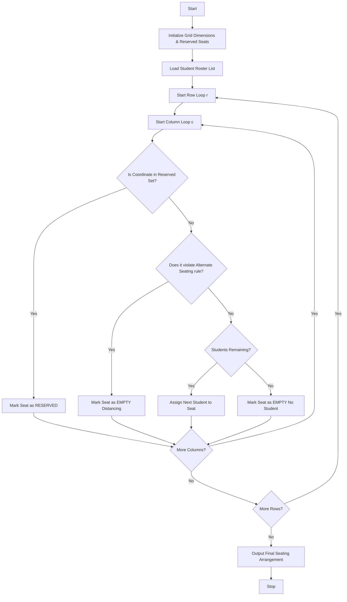

## Problem Statement

Develop a Nested Loop Examination Seating Generator system that allocates students to physical desk arrangements within a classroom. The system must handle row and column dimensions, process reserved positions (such as broken desks or pillars), enforce alternate seating restrictions (e.g., checkerboard distancing or anti-cheating patterns), and respect fixed classroom capacity limits while mapping student identifiers to coordinate positions.

---

## Algorithm

1. **Initialize Grid**:
* Create a 2D matrix representing the classroom grid of size $\text{Rows} \times \text{Columns}$.


2. **Mark Reserved Positions**:
* Populate designated reserved coordinates as unavailable or blocked.


3. **Iterate with Nested Loops**:
* Loop through each row and column index.


4. **Apply Restrictions**:
* Check if the current position violates alternate seating rules (e.g., where index sums dictate empty spacing).


5. **Assign Students**:
* Sequentially assign available students from the roster to valid, unreserved, non-distanced seats until all students are seated or capacity is exhausted.


6. **Output Layout**:
* Display the finalized seating grid map.


---

## Flowchart



---

## Python Source Code

```python
def generate_seating(rows, cols, students, reserved_seats):
    seating = [[None for _ in range(cols)] for _ in range(rows)]
    student_idx = 0
    
    for r in range(rows):
        for c in range(cols):
            if (r, c) in reserved_seats:
                seating[r][c] = "RESERVED"
                continue
            
            if (r + c) % 2 != 0:
                seating[r][c] = "EMPTY (Distancing)"
                continue
            
            if student_idx < len(students):
                seating[r][c] = students[student_idx]
                student_idx += 1
            else:
                seating[r][c] = "EMPTY (No Student)"
                
    return seating

if __name__ == "__main__":
    classroom_rows = 3
    classroom_cols = 4
    student_list = ["S101", "S102", "S103", "S104", "S105", "S106"]
    reserved = {(1, 1)}
    
    arrangement = generate_seating(classroom_rows, classroom_cols, student_list, reserved)
    for r_idx, row in enumerate(arrangement):
        print(f"Row {r_idx}: {row}")

```

---

## Sample Input

```python
rows = 3
cols = 4
students = ["S101", "S102", "S103", "S104", "S105", "S106"]
reserved_seats = {(1, 1)}

```

---

## Sample Output

```text
Row 0: ['S101', 'EMPTY (Distancing)', 'S102', 'EMPTY (Distancing)']
Row 1: ['EMPTY (Distancing)', 'RESERVED', 'EMPTY (Distancing)', 'S103']
Row 2: ['S104', 'EMPTY (Distancing)', 'S105', 'EMPTY (Distancing)']

```
