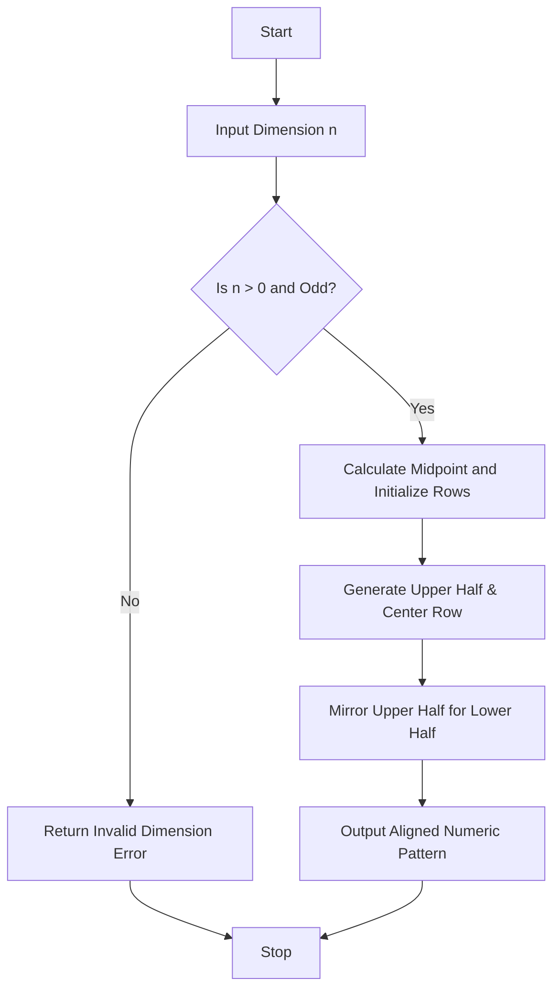

## Problem Statement

Develop an Advanced Numeric Pattern Generator that produces a symmetric hollow numeric diamond pattern based on user-specified dimensions. The system must validate that the input dimension is a positive odd integer, handle invalid inputs gracefully, and render a carefully aligned geometric pattern using nested loops and string formatting.

---

## Algorithm

1. **Input Collection & Validation**:
* Accept dimension $n$. Check if $n > 0$ and $n$ is an odd number. If invalid, return an error message.


2. **Calculate Midpoint**:
* Determine the middle index (`mid = n // 2`) to divide the pattern into an upper half, center row, and lower half.


3. **Generate Upper Half and Center**:
* Loop from index $0$ to `mid`. For the peak row ($i = 0$), center the first number. For subsequent rows, calculate leading spaces and inner hollow spaces, placing symmetric numbers at the boundaries.


4. **Generate Lower Half**:
* Mirror the generated upper rows in reverse order to complete the symmetric diamond shape.


5. **Output Results**:
* Join and display the lines to present a perfectly aligned pattern.


---

## Flowchart



---

## Python Source Code

```python
def generate_numeric_diamond(n):
    if n <= 0 or n % 2 == 0:
        return "Invalid dimension: Must be a positive odd integer."
    
    mid = n // 2
    lines = []
    for i in range(mid + 1):
        if i == 0:
            line = " " * mid + "1"
        else:
            line = " " * (mid - i) + str(i + 1) + " " * (2 * i - 1) + str(i + 1)
        lines.append(line)
        
    for i in range(mid - 1, -1, -1):
        lines.append(lines[i])
        
    return "\n".join(lines)

if __name__ == "__main__":
    dimension = 5
    print(generate_numeric_diamond(dimension))

```

---

## Sample Input

```python
n = 5

```

---

## Sample Output

```text
  1
 2 2
3   3
 2 2
  1

```
