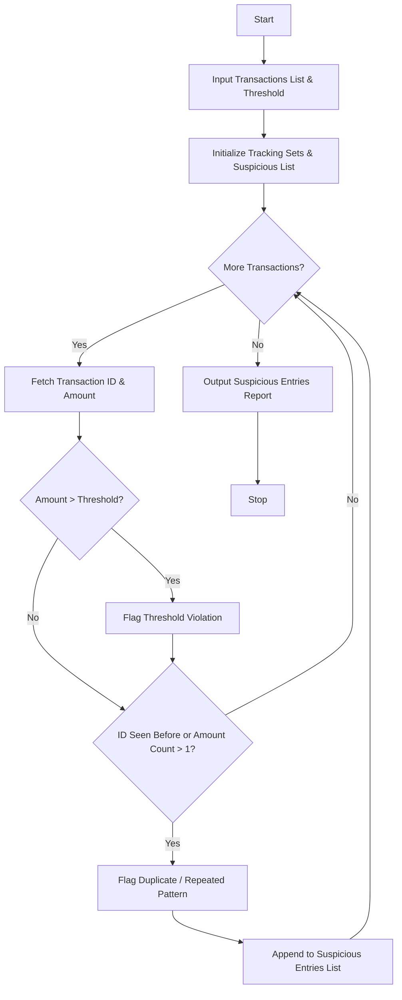

## Problem Statement

Develop a Repeated Transaction Detection system that processes financial transaction records containing transaction identifiers and amounts. The system must evaluate records against a predefined high-risk financial threshold, detect duplicate transaction IDs or repeated identical amount patterns, and compile a comprehensive list of suspicious entries for fraud analysis.

---

## Algorithm

1. **Initialize Data Structures**:
* Define tracking structures including a set for seen transaction IDs, a frequency dictionary for amounts, and a list for suspicious entries.


2. **Input Collection**:
* Accept the list of transaction records and the high-risk threshold limit.


3. **Process Each Transaction**:
* Extract the transaction ID and amount.
* Check if the amount exceeds the threshold limit; if so, flag as a threshold violation.
* Check if the transaction ID already exists in the seen set; if so, flag as a duplicate ID.
* Track and count amount frequencies to detect repeated identical payment amounts.


4. **Compile Suspicious Entries**:
* If any violation flags are raised, add the transaction details and violation reasons to the suspicious entries list.


5. **Output Results**:
* Display the compiled list of flagged suspicious transactions.


---

## Flowchart



---

## Python Source Code

```python
def detect_suspicious_transactions(transactions, threshold):
    seen_ids = set()
    amount_counts = {}
    suspicious_entries = []
    
    for tx in transactions:
        tx_id = tx["id"]
        amount = tx["amount"]
        is_suspicious = False
        reasons = []
        
        if amount > threshold:
            is_suspicious = True
            reasons.append("Threshold Violation")
            
        if tx_id in seen_ids:
            is_suspicious = True
            reasons.append("Duplicate ID")
        else:
            seen_ids.add(tx_id)
            
        amount_counts[amount] = amount_counts.get(amount, 0) + 1
        if amount_counts[amount] > 1:
            is_suspicious = True
            reasons.append("Repeated Amount")
            
        if is_suspicious:
            suspicious_entries.append({
                "id": tx_id,
                "amount": amount,
                "reasons": reasons
            })
            
    return suspicious_entries

if __name__ == "__main__":
    high_risk_threshold = 5000.0
    tx_list = [
        {"id": "T001", "amount": 1500.0},
        {"id": "T002", "amount": 6000.0},
        {"id": "T001", "amount": 1500.0},
        {"id": "T003", "amount": 2500.0},
        {"id": "T004", "amount": 2500.0}
    ]
    
    results = detect_suspicious_transactions(tx_list, high_risk_threshold)
    for res in results:
        print(f"Transaction ID: {res['id']}, Amount: ${res['amount']}, Flags: {', '.join(res['reasons'])}")

```

---

## Sample Input

```python
threshold = 5000.0
transactions = [
    {"id": "T001", "amount": 1500.0},
    {"id": "T002", "amount": 6000.0},
    {"id": "T001", "amount": 1500.0},
    {"id": "T003", "amount": 2500.0},
    {"id": "T004", "amount": 2500.0}
]

```

---

## Sample Output

```text
Transaction ID: T002, Amount: $6000.0, Flags: Threshold Violation
Transaction ID: T001, Amount: $1500.0, Flags: Duplicate ID, Repeated Amount
Transaction ID: T004, Amount: $2500.0, Flags: Repeated Amount

```
