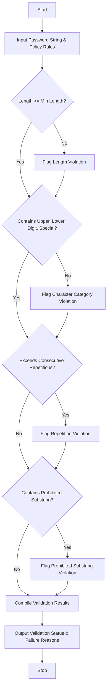

## Problem Statement

Develop a Password Policy Validation Engine that evaluates sample password strings against robust security criteria. The system must verify minimum length requirements, enforce character-category diversity (uppercase, lowercase, digits, and special characters), detect excessive consecutive character repetitions, and scan for prohibited substrings (such as common dictionary words or predictable sequences), providing a comprehensive explanation for each failed condition.

---

## Algorithm

1. **Initialize Policy Rules**:
* Define constraints including minimum length, required character classes, maximum allowed consecutive repeating characters, and a list of prohibited substrings.


2. **Input Collection**:
* Accept the candidate password string.


3. **Validate Length**:
* Check if the password length meets or exceeds the minimum threshold. If not, record a length violation.


4. **Validate Character Categories**:
* Check for the presence of at least one uppercase letter, one lowercase letter, one digit, and one special character using regular expressions. Record failures for any missing categories.


5. **Validate Repetitions**:
* Scan for consecutive identical characters exceeding the allowed repetition limit.


6. **Validate Prohibited Substrings**:
* Check if any forbidden words or patterns exist within the password string (case-insensitively).


7. **Output Results**:
* Aggregate all failure reasons and output the final validation status.


---

## Flowchart



---

## Python Source Code

```python
import re

def validate_password(password):
    errors = []
    if len(password) < 8:
        errors.append("Password must be at least 8 characters long.")
    if not re.search(r"[A-Z]", password):
        errors.append("Password must contain at least one uppercase letter.")
    if not re.search(r"[a-z]", password):
        errors.append("Password must contain at least one lowercase letter.")
    if not re.search(r"\d", password):
        errors.append("Password must contain at least one digit.")
    if not re.search(r"[!@#$%^&*(),.?\":{}|<>]", password):
        errors.append("Password must contain at least one special character.")
    if re.search(r"(.)\1{2,}", password):
        errors.append("Password contains excessive character repetition.")
    
    prohibited = ["password", "admin", "1234", "qwerty"]
    for p in prohibited:
        if p in password.lower():
            errors.append(f"Password contains prohibited substring: '{p}'.")
            
    is_valid = len(errors) == 0
    return is_valid, errors

if __name__ == "__main__":
    pwd = "Pass123password!"
    valid, reasons = validate_password(pwd)
    print(f"Password: {pwd}")
    print(f"Valid: {valid}")
    if not valid:
        print("Reasons:")
        for reason in reasons:
            print(f"- {reason}")

```

---

## Sample Input

```python
password = "Pass123password!"

```

---

## Sample Output

```text
Password: Pass123password!
Valid: False
Reasons:
- Password contains prohibited substring: 'password'.

```
