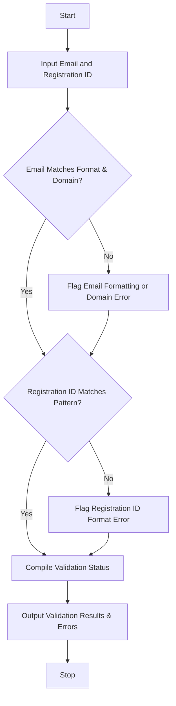

## Problem Statement

Develop a Student Email and Identifier Validation system that processes student email strings and university registration identifiers. The system must verify structural integrity against formatting rules, detect malformed separators (such as incorrect placement of '@' or dots), identify invalid character groups, ensure correct institutional domains, and validate standard registration ID patterns (e.g., Year + Department + Sequence), reporting all specific failures clearly.

---

## Algorithm

1. **Initialize Patterns**:
* Define regular expression rules for valid email structures, institutional domain constraints, and registration ID formats.


2. **Input Collection**:
* Accept candidate student email and registration identifier strings.


3. **Validate Email**:
* Check local part formatting, separator validity, and verify that the domain matches the official institutional suffix. Record specific errors if checks fail.


4. **Validate Registration Identifier**:
* Verify length, character groupings (e.g., numeric year prefix, uppercase department code, and numeric sequence), and separator conventions. Record errors if malformed.


5. **Output Results**:
* Compile validation status and output all identified structural errors or confirmation of success.


---

## Flowchart



---

## Python Source Code

```python
import re

def validate_student_record(email, reg_id):
    errors = []
    
    email_pattern = r"^[a-zA-Z0-9_.+-]+@[a-zA-Z0-9-]+\.[a-zA-Z0-9-.]+$"
    if not re.match(email_pattern, email):
        errors.append("Invalid email structure or malformed separators.")
    elif not email.endswith("@university.edu"):
        errors.append("Email must belong to the official '@university.edu' domain.")
        
    reg_pattern = r"^\d{2}[A-Z]{3}\d{4}$"
    if not re.match(reg_pattern, reg_id):
        errors.append("Invalid registration identifier format (Expected YYDEPRNNNN).")
        
    is_valid = len(errors) == 0
    return is_valid, errors

if __name__ == "__main__":
    test_email = "john.doe@university.com"
    test_reg_id = "24CS1042"
    
    valid, reasons = validate_student_record(test_email, test_reg_id)
    print(f"Email: {test_email}")
    print(f"Registration ID: {test_reg_id}")
    print(f"Valid: {valid}")
    if not valid:
        print("Errors:")
        for reason in reasons:
            print(f"- {reason}")

```

---

## Sample Input

```python
email = "john.doe@university.com"
reg_id = "24CS1042"

```

---

## Sample Output

```text
Email: john.doe@university.com
Registration ID: 24CS1042
Valid: False
Errors:
- Email must belong to the official '@university.edu' domain.

```
